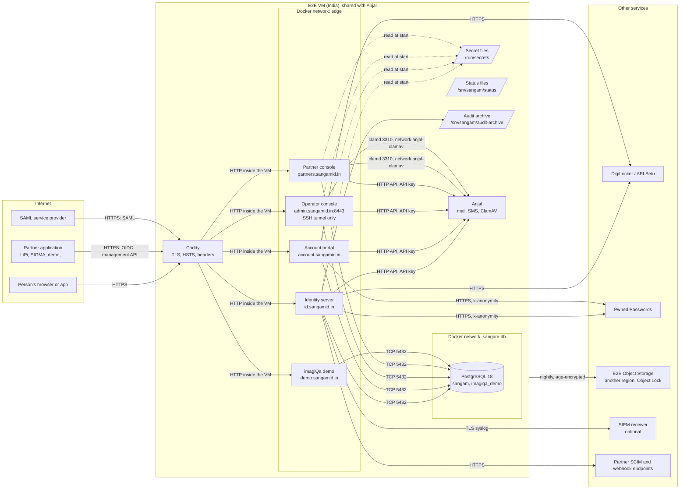

# Architecture, data flows and trust boundaries

*rc.8 (ASVS V1.1.4, V1.1.5, V1.4.1). Reviewed and updated at every release, along with the
[threat model](threat-model.md). Last reviewed: 1.0.0-rc.8, 11 October 2026.*

This is how Sangam fits together in production, where data goes, and where trust changes hands. Each remote service has
its own short security analysis in section 5.

## 1. The picture

## 2. Components and what each does

| Component | Function | Runs as | Holds |
|---|---|---|---|
| Caddy | Terminates TLS (automatic certificates), redirects HTTP, adds HSTS and security headers, strips `Server`, routes by host name, health-checks the hosts | user 1000, no capabilities, read-only filesystem (rc.9) | TLS certificates and their keys (`caddy_data`) |
| Identity server | Sign-in, registration, the eight account screens, OpenID Connect and OAuth 2 (OpenIddict), SAML, the management API, DigiLocker verification at sign-in, back-channel logout, SCIM and webhook delivery, audit archive, retention and inactivity sweeps, monitoring evaluation and alerts, the start-up key-fingerprint check | non-root (`APP_UID`) | Token signing and encryption certificates, key-ring certificate, pepper, SAML keys, DigiLocker subject key, client secrets of the consoles (to register them) |
| Account portal | A person's own account: profile, security, sessions, consents, export, deletion, merge, DigiLocker verification | non-root | Key-ring certificate, pepper, its client secret, DigiLocker subject key |
| Operator console | Sangam's own operators: users, applications, operators, recoveries, monitoring, templates, grievances. Not on the internet: reached only through an SSH tunnel to the VM's loopback (OI-059) | non-root | Key-ring certificate, pepper, its client secret |
| Partner console | An application's administrators: roles, organisations, members, attributes, settings, policies, webhooks, evidence packs | non-root | Key-ring certificate, pepper, its client secret |
| imagiQa demo | A sample partner application (D-I), its own database, reached on its own network (rc.9) | non-root | Its client secret, its own data-protection keys |
| PostgreSQL 18 | All of Sangam's data: accounts, credentials (hashed or encrypted), grants, tenancy, audit log (hash-chained, append-only for the application role), data-protection key ring (encrypted), metrics, host reports | its image's user | Everything in SGM-910's Confidential and the Restricted credentials |
| Anjal | imagiQa's mail server: sends Sangam's e-mail (and later SMS) through its API; runs ClamAV for uploaded logos | separate stack and repository | Messages in its own queue |
| Backup job (cron) | Nightly `pg_dump`, container logs and new audit-archive files, encrypted with `age` for the founder's offline key, uploaded under Object Lock | root on the VM | The `age` public key only |

rc.9 (ASVS V1.14.5, V1.2.1): every container — the hosts, the demo, Caddy and PostgreSQL — runs on a read-only filesystem
with a private `/tmp`, without Linux capabilities (PostgreSQL keeps the five its start-up needs to hand over to its own
user), unable to gain privileges, and with memory and process limits. The Kubernetes manifests set the same.

## 3. Data flows

| # | Flow | From → to | Carries | Protection |
|---|---|---|---|---|
| F1 | Sign-in and account screens | Browser → Caddy → identity server, portal | Passwords, codes, passkey assertions, profile | TLS 1.2+ at Caddy; antiforgery; rate limits; HSTS |
| F2 | OpenID Connect | Application ↔ identity server | Authorization codes (PKCE), tokens, userinfo | TLS; registered redirect addresses only; PKCE; signed and encrypted tokens; refresh-token rotation |
| F3 | Management API | Application → identity server | Roles, organisations, memberships, attributes | Client-credentials token with `sangam.manage`; scoped to the calling application; JSON only; every refusal and every read of people audited |
| F4 | SAML | Service provider ↔ identity server | Assertions with a pairwise id | Signed assertions; registered service providers only |
| F5 | Consoles | Browser → consoles (Blazor Server) | Operator and partner actions | OIDC sign-in with an authenticator; rank checks in the services; every refusal audited |
| F6 | Database | Hosts → PostgreSQL | All data | Private Docker network; a separate application role that cannot alter the audit table; plain TCP inside the VM (decision 2) |
| F7 | Mail and SMS | Hosts → Anjal API | Message text, the recipient | API key; https, or http only to a private host; Anjal sends outbound mail with STARTTLS always (decision 4) |
| F8 | Virus scan | Consoles → Anjal's ClamAV | Uploaded logo bytes | Private network `anjal-clamav` only |
| F9 | DigiLocker | Identity server, portal ↔ DigiLocker | Authorization code; name, date of birth, gender; the DigiLocker id (hashed at once) | HTTPS with revocation checks; PKCE; the id kept only as HMAC-SHA-256 |
| F10 | Breach check | Hosts → Pwned Passwords | Five characters of a password's SHA-1 | k-anonymity; HTTPS with revocation checks |
| F11 | SCIM and webhooks | Identity server → partner endpoints | Account and membership changes | `OutboundHttp`: https only, no redirects, private addresses refused, revocation checked; webhooks signed; partner-registered destinations accepted (decision 9) |
| F12 | Back-channel logout | Identity server → applications | Logout tokens | `OutboundHttp` as F11 |
| F13 | SIEM | Identity server → receiver | Audit events | TLS 1.2+, optional client certificate and private authority; revocation checked |
| F14 | Backups | VM → E2E Object Storage | Database dump, logs, audit archive | Encrypted with `age` before it leaves; Object Lock; another region |
| F15 | Secrets | Secret files → hosts | Keys and secrets | Root-only files; fingerprints checked at start (rc.8); read from a Vault-compatible store when `Sangam:Secrets:Source=vault` |

## 4. Trust boundaries

| Boundary | Between | What is checked as data crosses it |
|---|---|---|
| TB1 Internet ↔ Caddy | Anyone ↔ the VM | TLS; only four host names are routed publicly — the operator console only on the VM's loopback, through SSH (OI-059); the firewall admits 80, 443 and SSH (key-only, section 6 of the deployment guide) |
| TB2 Caddy ↔ hosts | The edge ↔ the applications | Forwarded headers trusted only from Caddy's network; `AllowedHosts` per host (rc.8); only the HTTP methods Sangam uses (rc.8) |
| TB3 Person ↔ Sangam | An unauthenticated or signed-in person ↔ their account | Authentication, step-up and fresh sign-in for sensitive changes; every action limited to the person's own account |
| TB4 Application ↔ Sangam | A partner application ↔ Sangam's data | The application's client identity; everything scoped to its own grants, organisations and people; consent first |
| TB5 Partner administrator ↔ Sangam | An application's staff ↔ that application's data | Administrator role checked in each service method; owner-only actions; refusals and reads audited (rc.8) |
| TB6 Operator ↔ Sangam | Sangam's staff ↔ all accounts | Reachable only through an SSH tunnel (key-only SSH, forwarding to the console alone); rank checked in each service method; authenticator required; every read and refusal audited |
| TB7 Hosts ↔ PostgreSQL | Application code ↔ the data | Separate owner and application roles; parameterised queries (EF Core); audit table protected by a trigger |
| TB8 Sangam ↔ outside services | Sangam ↔ Anjal, DigiLocker, Pwned Passwords, partner endpoints, SIEM, backup storage | Certificates validated with revocation (rc.8); outbound to partner addresses only through `OutboundHttp`; backups encrypted before leaving |
| TB9 Root on the VM ↔ everything | The operator of the machine | Not a boundary Sangam can enforce today (decision A6): secrets are files. Compensated by the key-fingerprint check, SSH hardening and the offline key copies, until imagiQa's vault exists |

## 5. Remote services: security analysis

| Service | What Sangam trusts it with | If it is compromised or down | Controls |
|---|---|---|---|
| Anjal (mail, SMS) | The text of every message, including sign-in codes and links | An attacker could read codes in transit through Anjal; when down, no codes or alerts are sent | API key per sender; Anjal on the same VM today; codes short-lived and single-use; STARTTLS always outbound; monitoring watches Anjal and Anjal's watchdog watches Sangam |
| Anjal's ClamAV | Logo bytes | A missed virus in a logo; when down, uploads are refused | Private network only; uploads refused while the scanner does not answer; logos served with a strict content policy |
| DigiLocker | Identity attributes for verification and recovery | False verification would bind a wrong identity; when down, verification and recovery wait | PKCE; https with revocation; the id hashed with a key never changed; records that do not match wait for operator review |
| Pwned Passwords | Five hex characters of a SHA-1 | Nothing about the password; when down, the built-in list is the check and the founder is alerted after an hour | k-anonymity; https with revocation |
| Partner SCIM and webhook endpoints | Account and membership changes for that partner's own people | The partner's own data only; when down, deliveries retry and the partner is alerted | Destinations registered by the partner (decision 9); https only; private networks refused; signed webhooks; firewall allows outbound 443 only |
| SIEM receiver (optional) | Every audit event | Audit content disclosed to the receiver's operator | TLS with a private authority and client certificate; events carry no secrets; off unless configured |
| E2E Object Storage | Encrypted backups | Nothing readable without the founder's offline key; Object Lock stops deletion | `age` encryption before upload; another region; restore drills |
| E2E VM and its operator | Everything | Full compromise (TB9) | Accepted for the pilot (A6); see the threat model |

## 6. Related documents

- [Threat model](threat-model.md) — the threats at each boundary and how they are met.
- [Protection levels](protection-levels.md) — SGM-910's classes mapped to protections.
- [Input and output rules](input-output-rules.md), [log-content policy](log-content-policy.md),
  [cache and request-parameter review](cache-and-parameters-review.md), [key compromise](key-compromise.md).
- `deploy/production/README.md` — the deployment, including SSH hardening (section 6).
